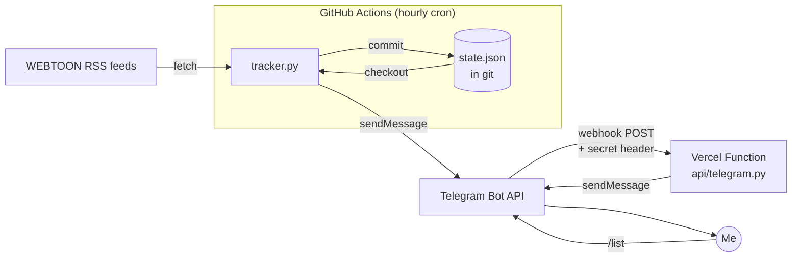

# Webtoon Chapter Tracker

[](https://github.com/Htet-Myark/webtoon-tracker/actions/workflows/tests.yml)
[](https://github.com/Htet-Myark/webtoon-tracker/actions/workflows/check.yml)

A personal Telegram bot that messages me the moment a new episode of a series I follow drops on [WEBTOON](https://www.webtoons.com), and answers commands instantly.

It runs entirely on free tiers: **no server, no database, no dependencies** (Python standard library only), and costs $0 a month.

```
📖 New on Lookism
Ep. 620: Gapryong Kim (11)
https://www.webtoons.com/en/drama/lookism/ep-620-gapryong-kim-11/viewer?title_no=1049&episode_no=620
```

```
/list
📚 Tracking 5 series:
1. Lookism
   https://www.webtoons.com/en/drama/lookism/list?title_no=1049
2. The Gwichon Village Mystery
   ...
```

## Architecture



The bot has two halves with different jobs:

| Part | Runs on | Job |
|---|---|---|
| **Episode checker** (`tracker.py`) | GitHub Actions, every hour | Fetches each series' official RSS feed, diffs it against what it has seen, and sends a message per new episode. |
| **Command handler** (`api/telegram.py`) | Vercel serverless function | Receives Telegram's webhook and replies to `/list` instantly. |

## Design decisions

**State lives in git, not a database.** Seen episode IDs are stored in `state.json`, and the workflow commits it back after each run. For a few hundred IDs a database would be pure overhead; git gives free persistence, plus a full history of every episode the bot noticed (`git log state.json`). The state is capped at 200 IDs per series, keeping old IDs that have scrolled out of the 20-item feed so they're never re-announced.

**No spam on first run.** A newly added series has its whole back catalogue in the feed. The first check records those episodes silently and only later releases trigger messages.

**Webhook instead of polling for commands.** An hourly job could answer commands by polling `getUpdates`, but replies would take up to an hour. Running the checker every few minutes instead would blow through the 2,000 free Actions minutes a private repo gets. A webhook on Vercel replies in about a second, costs nothing, and the checker stays hourly. (Telegram disables `getUpdates` once a webhook is set, so commands live only in the function.)

**Official RSS, not scraping.** No logins, no HTML parsing that breaks on redesigns, and it respects the site.

**Deploys only when it matters.** Vercel redeploys from GitHub on push, but `vercel.json`'s `ignoreCommand` skips builds when the only change is the hourly `state.json` commit.

## Security

- **Webhook authentication.** Telegram is registered with a random `secret_token`, and the function rejects (401) any request without the matching `X-Telegram-Bot-Api-Secret-Token` header. If the secret isn't configured, it rejects everything rather than failing open.
- **Owner-only replies.** Messages from any chat other than `TELEGRAM_CHAT_ID` are ignored, so a stranger who finds the bot gets nothing.
- **Secrets never touch the repo.** The bot token, chat ID and webhook secret live in GitHub Actions secrets and Vercel encrypted (Sensitive) env vars.
- **Robust to bad input.** Malformed or unexpected updates get a `200` so Telegram doesn't retry them forever, and a failed reply never crashes the function.
- **Token rotation.** The token was rotated once after it appeared in a local log: revoke with @BotFather, update both secret stores, redeploy, re-register the webhook.

## Tests

28 unit tests, standard library `unittest`, run in CI on Python 3.12 and 3.13:

```bash
python -m unittest discover -s tests -v
```

- `tests/test_tracker.py`: RSS parsing, first-run behaviour, oldest-first notifications, state trimming and retention, feed errors, dry-run, and validation of `series.json`.
- `tests/test_webhook.py`: starts the real handler on a local HTTP server and checks auth (missing, wrong, or unset secret), owner-only replies, command parsing, malformed bodies, and Telegram outages.

## Project layout

```
tracker.py              hourly episode checker (GitHub Actions)
api/telegram.py         Telegram webhook (Vercel function)
series.json             series to follow
state.json              seen episode IDs, committed by the workflow
tests/                  unit tests
.github/workflows/
  check.yml             hourly cron
  tests.yml             CI
vercel.json             function config + skip state-only deploys
```

## Run it yourself

**1. Pick series.** Open a series on webtoons.com and change `/list?title_no=` in the URL to `/rss?title_no=`, then add it to `series.json`:

```json
[
  { "name": "Lookism", "rss": "https://www.webtoons.com/en/drama/lookism/rss?title_no=1049" }
]
```

**2. Create a bot.** Message @BotFather, send `/newbot`, and keep the token. Send your bot any message, then get your chat ID from `https://api.telegram.org/bot<TOKEN>/getUpdates`.

**3. Try it locally.**

```bash
python tracker.py --dry-run   # prints instead of sending; first run just records episodes
```

**4. Hourly checks.** Push to GitHub and add `TELEGRAM_BOT_TOKEN` and `TELEGRAM_CHAT_ID` under **Settings > Secrets and variables > Actions**. Trigger it once from the **Actions** tab.

**5. Instant commands.** Import the repo into Vercel and add `TELEGRAM_BOT_TOKEN`, `TELEGRAM_CHAT_ID` and a random `TELEGRAM_WEBHOOK_SECRET` as env vars. Then point Telegram at it:

```bash
curl "https://api.telegram.org/bot<TOKEN>/setWebhook" \
  -d url=https://<your-app>.vercel.app/api/telegram \
  -d secret_token=<TELEGRAM_WEBHOOK_SECRET> \
  -d 'allowed_updates=["message"]'
```

## Limits

- RSS only includes publicly released episodes, not Fast Pass (paid early access) episodes.
- GitHub pauses scheduled workflows after 60 days without repo activity. New episodes create state commits, which usually keep it alive.
- Cron runs can start a few minutes late when GitHub is busy.

## Roadmap

- `/add <link>` and `/remove` commands that commit to `series.json` through the GitHub API
- Daily digest mode instead of one message per episode
- Alert me when a feed starts failing (series renamed or removed)
